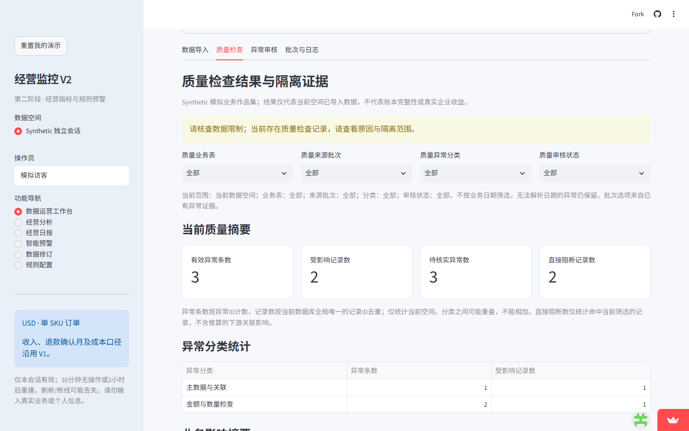
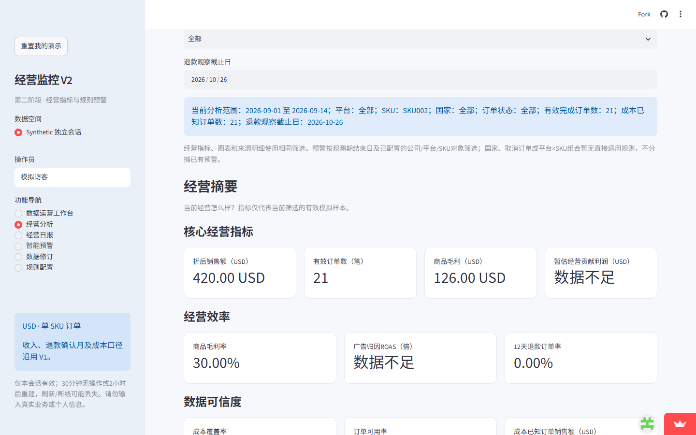
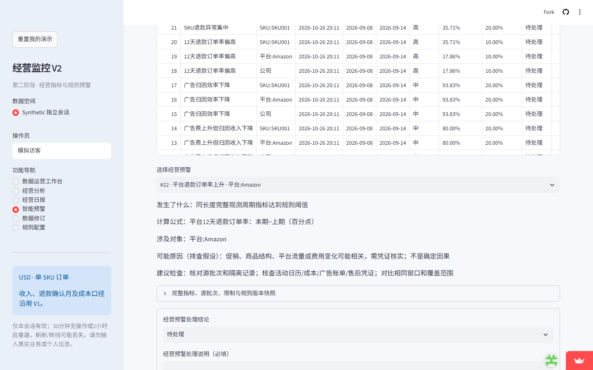
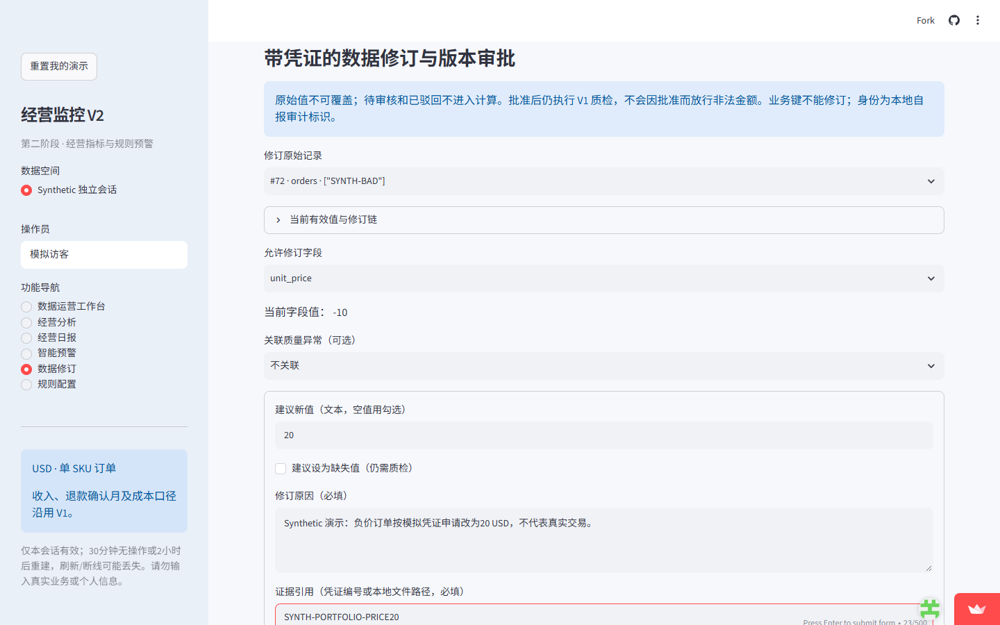
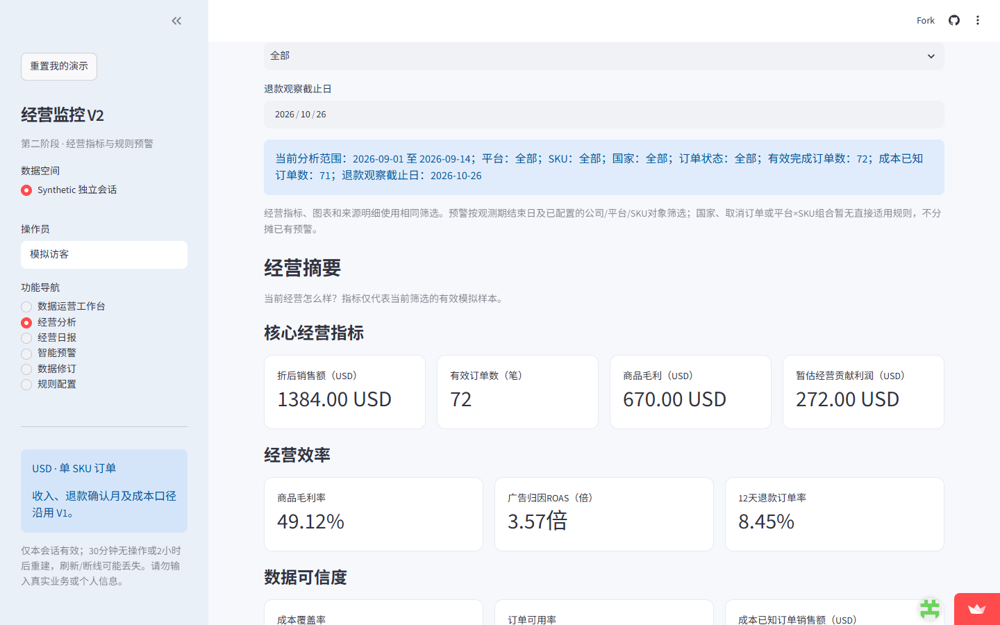
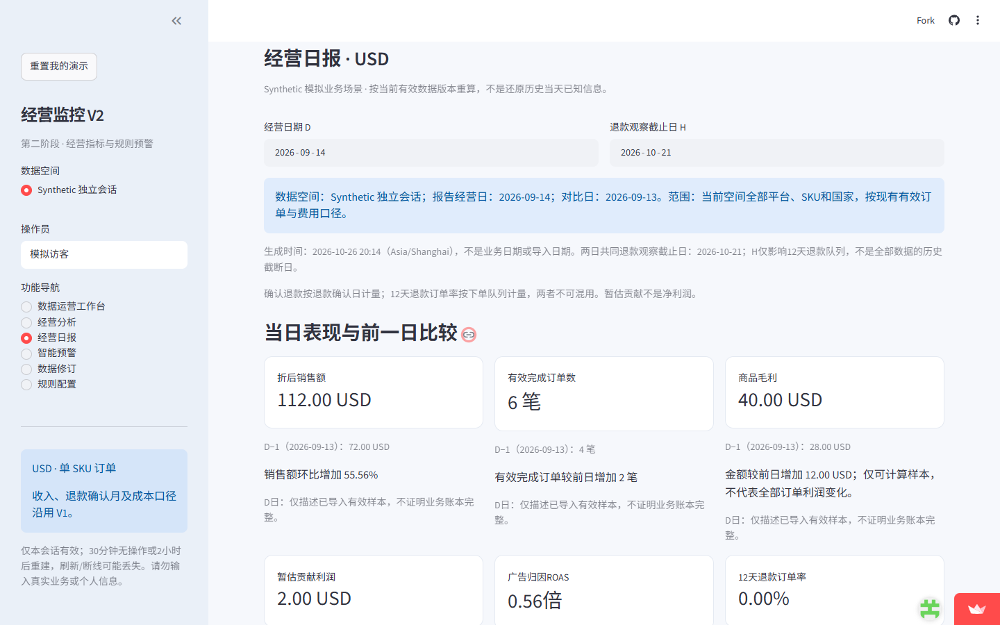

# 跨境电商智能经营监控系统 V2.1

*Cross-border E-commerce Business Analytics & Monitoring System*

**让订单问题有证据、经营指标有口径、每次数据修订都能解释清楚。**

[免费在线演示](https://ecommerce-business-analysis-izcmrhydxddnasxqdbdxxr.streamlit.app/) · [核心功能](#features) · [业务案例](docs/portfolio/BUSINESS_CASE.md) · [真实截图](#screenshots) · [技术架构](docs/portfolio/ARCHITECTURE.md) · [本地运行](#local-run) · [项目限制](#limits)

[求职简历与90秒面试介绍](docs/portfolio/INTERVIEW_GUIDE.md) · [演示视频说明](#video) · [展示成果与证据](docs/portfolio/SHOWCASE.md)

> **公开版已上线，全部使用 Synthetic 合成模拟数据。** 不支持上传真实业务文件；每个访客使用临时独立演示会话，状态不保证永久保存。请勿输入真实企业、客户或凭证信息。可用“重置我的演示”重新开始；冷启动时请等待界面加载。本项目尚未经过真实企业生产数据验证。

面向跨境电商数据运营岗位的个人作品集：把**质量检查 → 异常隔离 → 经营分析 → 风险预警 → 审核修订 → 日报生成**连接成可复核的工作流程。项目使用 Codex 辅助开发；作者负责业务问题定义、口径设计、证据核查与结果解释，不把工具生成代码本身等同于业务验证。

## 招聘方可以先看什么

1. 打开在线体验，在“数据运营工作台”查看负价订单 SYNTH-BAD 与未知成本订单 SYNTH-UNKNOWN。
2. 在“经营分析”切换 SKU001、SKU002，注意“数据不足”不等于零。
3. 按[业务案例](docs/portfolio/BUSINESS_CASE.md)完成一次模拟修订，再查看日报如何变化。

**推荐演示主线：** SYNTH-BAD负价隔离 → 模拟凭证审批 → 指标重算 → 发现库存差异 → 修正日报。[完整六场景业务案例](docs/portfolio/BUSINESS_CASE.md)同时解释原Excel流程和人工核查边界。

<a id="features"></a>

## 它替代哪些重复工作

以下金额均为 USD，来自 2026-10-26 公开 Synthetic 演示实操，不是真实企业收益。

|运营任务|系统实际完成的工作|具体例子与人工边界|
|---|---|---|
|订单质量核查|定位错误字段、来源批次与原始行，按规则隔离|SYNTH-BAD 单价 -10 被整行隔离；需人工核对正确成交价格。重复识别是既有导入能力，本次线上未重新上传验证|
|核查成本缺失|区分有效收入与可计算利润样本|SYNTH-UNKNOWN 的20美元收入保留，但缺少 SKU999 成本，不能把成本填0|
|商品经营比较|使用统一筛选计算销售、毛利、贡献与成本覆盖|SKU001 销售924、毛利532；SKU002 销售420、毛利126，贡献数据不足|
|风险跟进|手动检测库存、销售、毛利、广告与退款规则，保存证据和状态|Amazon 退款率从2.38%升至17.86%，上升15.48个百分点；需调查退款原因|
|修订与追溯|保留原值、凭证引用、申请审批和有效版本，批准后重新质检|单价 -10→20 后，全期销售1364→1384；新增库存与订单差异仍需核查|
|经营日报|计算六项KPI、严格前日比较，生成可离线打开的HTML|9月14日修订后销售112、贡献2，ROAS仍0.56；贡献不是净利润|

## 业务案例：从错误订单识别到经营日报修正

1. **发现**：原始记录72、SYNTH-BAD，来源文件第73行，单价为-10。单价和优惠关系检查同时命中；3条异常只影响2条记录。
2. **隔离**：错误订单不进入销售与利润；另一张未知成本订单只隔离利润，保留20美元收入。
3. **核实**：查看原始JSON、规则、批次和行号；正确价格必须靠业务凭证确认。
4. **申请与批准**：仅在模拟会话把 unit_price 从-10改为20，填写模拟原因与凭证；待审批不生效，批准后重新质检。
5. **重算**：全期销售1364→1384，订单71→72，毛利658→670，暂估贡献262→272。收入增加20而非30，因为原负价订单从未进入有效汇总。
6. **继续核查**：修复后新增SKU001库存出库与有效订单不一致的问题。修订一张订单不代表上下游数据全部正确。
7. **汇报**：D=2026-09-14、H=2026-10-21，日报销售92→112，毛利28→40，暂估贡献-8→2；ROAS仍为0.56，未知成本仍需补证据。

[六场景运营案例](docs/portfolio/BUSINESS_CASE.md) · [按控件逐步复现](docs/portfolio/INTERVIEW_CASE.md) · [岗位简历与十个面试追问](docs/portfolio/INTERVIEW_GUIDE.md)。

## 技术实现

- **Python**组织导入、质检、指标、预警、修订和日报服务；金额计算使用Decimal。
- **Pandas**负责表格读取、标准化、质量结果整理和分组展示。
- **SQL / SQLite**保存批次、不可变原始记录、异常、修订版本、审批与预警历史；V1另保留SQL分析案例。
- **Streamlit**提供六个操作模块和HTML下载；页面、预警和日报复用MetricCenter，不各写一套利润公式。
- **pytest**验证业务服务与页面；历史本地公开入口验收为188项通过，本轮文档发布不重跑全量。
- **Playwright / Microsoft Edge**用于公开网址真实操作、下载与离线核对。
- **Git / GitHub**管理代码、展示证据和版本，V1源码与历史分析资料保留。

~~~mermaid
flowchart LR
    A[本地六表导入 / 公开模拟种子] --> B[原始记录与来源]
    B --> C[质量检测与异常隔离]
    R[人工申请与批准修订] --> C
    C --> M[统一指标服务]
    M --> D[经营分析]
    M --> E[手动规则检测与证据]
    M --> F[经营日报与离线HTML]
    E --> F
~~~

[架构与函数入口](docs/portfolio/ARCHITECTURE.md) · [13条规则](v2/docs/ALERT_RULES.md) · [修订流程](v2/docs/REVISION_WORKFLOW.md)。

<a id="screenshots"></a>

## 真实线上画面

截图来自 Playwright 正常启动 Microsoft Edge 后访问公开网址。未修改页面数字；使用模拟操作员和模拟凭证。界面标题保留“V2”，功能版本为 V2.1。[截图出处与验证边界](docs/portfolio/SHOWCASE.md)。

### 质量问题有来源，而不只是一个红色数字



### 商品比较同时披露缺失数据




### 预警保留窗口、阈值与核查依据



### 修订申请保留原值、原因与模拟凭证



### 审批后重算，再生成经营日报





<a id="video"></a>

## 演示视频

已完成**5分钟、1080p、H.264 MP4**中文字幕演示（无配音），采用真实Edge线上页面截图剪辑，明确标记非连续录屏。2026-10-26已验证完整解码、实际播放与章节跳转；[验证摘要](docs/portfolio/presentation-validation.json)记录文件SHA-256。

**公开播放链接尚未提供。** 视频保留在作者本地，不将MP4提交Git，不编造不存在的观看地址。可先[在线操作系统](https://ecommerce-business-analysis-izcmrhydxddnasxqdbdxxr.streamlit.app/)，或阅读[完整分镜与讲解稿](docs/portfolio/VIDEO_SCRIPT.md)、[独立中文字幕](docs/portfolio/DEMO.zh-CN.srt)。

## 指标口径：先明确能算什么

|指标|口径|不能混淆的内容|
|---|---|---|
|折后销售额|有效completed订单的数量×单价−整单优惠|含未知成本收入；单SKU订单|
|商品毛利|成本已知销售额−对应商品成本|不扣物流、佣金、退款和广告；未知成本不填0|
|暂估贡献|毛利−物流−佣金−确认退款−已记录广告|部分样本与已记录费用，不是完整净利润|
|广告ROAS|同范围广告归因收入÷广告花费|归因收入不能再加到订单销售额|
|12天退款订单率|12天内有有效批准退款的不同订单÷成熟有效成本已知订单|按下单队列；退款费用按确认日，两者不是同一指标|
|成本覆盖率|成本已知销售额÷有效销售额|订单可用率和成本覆盖率都不能证明账本收齐|

日报严格比较D与D−1，H只约束退款队列，不是全库历史快照。当前指标按有效版本重算；历史预警保留原证据，修订后需手动重新检测。建议是确定性核查提示，不是AI根因分析。[详细指标定义](v2/docs/METRIC_DEFINITIONS.md)。

## 公开演示与本地完整模式

|内容|公开演示|本地完整模式|
|---|---|---|
|入口|上方免费在线体验链接|v2/app.py|
|数据|预载Synthetic，禁止真实文件上传|支持模拟数据和符合模板的业务数据；CSV、单表/多表XLSX六表导入|
|操作|分析、质量、预警、模拟审核修订、日报|同一业务流程及导入管理|
|保存|临时独立会话，空闲30分钟或存活2小时后可能重建|本地SQLite与上传原件，需要自行备份|
|身份|操作员为自报演示标识，无认证|同样不是生产级权限系统|

本地功能依据代码与既有验收；2026-10-26线上实操没有重新验证真实文件导入。详见[公开模式与部署说明](docs/portfolio/CLOUD_DEPLOY.md)。

## 当前状态与证据

- **V2.1已开发完成，公开Synthetic演示已上线。** 应用代码基线为部署分支的360ed12；后续作品集提交只整理文档和展示材料。线上页面未暴露提交哈希，不将本地Git哈希冒充为服务器运行版本证明。
- **本地自动化，2026-10-22历史记录**：12项公开模式专项、188项全量通过；本轮只读取原始结果，没有重跑全量。[原始输出摘要](docs/portfolio/validation-20261022.txt)。
- **线上业务实操，2026-10-26**：Playwright + Edge完成六模块操作、筛选、模拟预警处理、修订审批和HTML离线核对；展示补拍继续使用公开网址。
- **未经过真实企业生产数据验证**，测试通过不代表生产级可靠性。

<a id="limits"></a>

## 明确边界

单企业、小批量全量重评、USD单币种、单SKU订单、静态采购成本。没有真实平台自动同步、定时检测通知、AI助手或生产级权限；没有完整财务费用体系和账本完整性证明。原文件与SQLite不属于同一原子事务，备份与恢复需另行管理。公开演示不是生产级SaaS。

企业试用前应补齐平台字段适配、多SKU订单、多币种、历史成本、费用与对账、身份权限和职责分离、持久化及恢复机制。尚未实现的能力不列为项目成果。

<a id="local-run"></a>

## 安装与启动

在仓库根目录使用 Windows PowerShell。已验收平台为 Windows / Python 3.11 / Edge：

```powershell
py -3.11 -m venv v2/.venv
v2/.venv/Scripts/python.exe -m pip install -r v2/requirements-lock.txt
v2/.venv/Scripts/python.exe -m pip check
$env:V2_DATA_DIR = Join-Path (Get-Location) 'v2/runtime/portfolio-demo'
v2/.venv/Scripts/python.exe -m streamlit run v2/app.py --server.address 127.0.0.1 --server.port 8502 --server.headless true --server.maxUploadSize 20 --browser.gatherUsageStats false
```

打开 <http://127.0.0.1:8502>，按 Ctrl+C 停止。首次安装需网络，核心应用本地运行，不需要密钥。锁定文件记录验收依赖；`v2/requirements.txt` 为兼容范围。其他操作系统未进行同等浏览器验收。

选择“第二阶段独立模拟演示”→“数据运营工作台”→“批次与日志”→“导入14天第二阶段模拟数据”。六表样例已附带，无需运行生成脚本。不要在此空间混入两天正常/错误场景；重演时使用新的 `V2_DATA_DIR`，不要清空已有库。[完整演示](docs/portfolio/DEMO.md)包含修订前后的对账点。

未设置变量时使用 `v2/runtime/`。停止应用后备份整个数据目录，包含 SQLite、WAL 和原上传文件；不要只复制主数据库。`business` 与 `demo` 逻辑隔离；第二阶段模拟使用数据目录下 `phase2_demo/` 独立库。

## 进一步阅读

[展示成果与素材清单](docs/portfolio/SHOWCASE.md) · [本地演示流程](docs/portfolio/DEMO.md) · [运行与验证索引](v2/README.md) · [V1分析案例](README_V1.md)

原创代码、文档和模拟数据沿用[MIT许可证](LICENSE)，第三方资源遵循[各自许可](docs/third_party_notices.md)。
