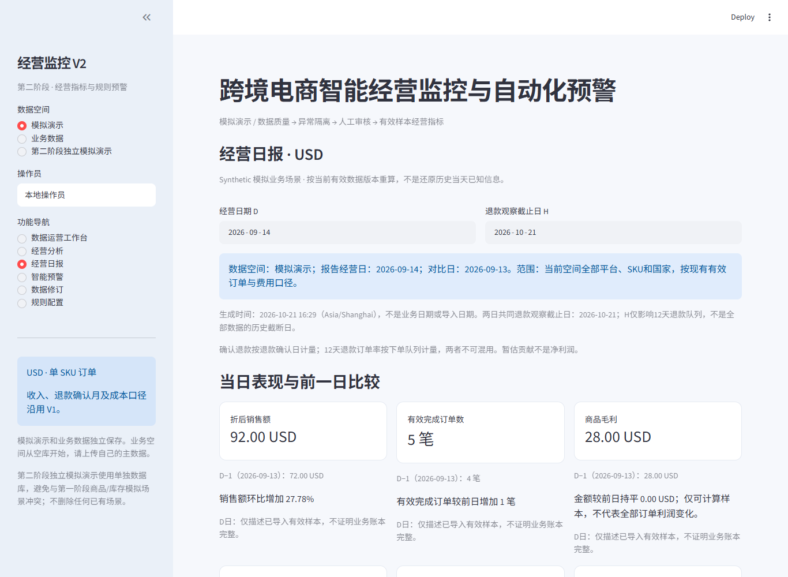
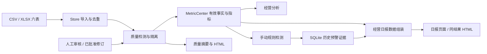

# 跨境电商智能经营监控系统 · V2.1

**从六表导入、质量治理到经营指标、可追溯预警与离线日报的本地应用。**

> 本仓库附带的全部经营数据、截图和演示结果均为 **Synthetic 合成模拟数据**，不代表真实企业经营收益。项目使用 Codex 辅助开发，以确定性指标、自动化测试及真实浏览器验证约束结果。应用可上传数据，但作品集不包含真实企业或客户数据。

面向跨境电商运营、数据运营和分析人员，解决重复上传、异常记录混入利润、退款日期口径混用、预警缺少依据和日报难以复核的问题。适合小批量、本机、单企业使用，不是在线 SaaS 或生产级财务系统。

[快速启动](#安装与启动) · [演示流程](docs/portfolio/DEMO.md) · [系统架构](docs/portfolio/ARCHITECTURE.md) · [截图与发布说明](docs/portfolio/RELEASE.md) · [保留的 V1 分析案例](README_V1.md)

## 实际界面



真实 Edge 截图，来自 V2.1 C2 独立模拟库验收。界面“V2”为保留的产品标题；当前代码包含 V2.1 质量报告与经营日报。更多截图及其版本来源见[展示材料](docs/portfolio/RELEASE.md#截图来源)。

## 已实现功能

|模块|实际能力与边界|
|---|---|
|六表导入|CSV、单表 XLSX、多工作表 XLSX；订单、商品、客户、库存、退款、广告；字段模板、原文件下载、批次与日志|
|质量治理|标准化、重复识别、业务键冲突与异常隔离；分类/批次筛选、业务影响摘要、原始证据、CSV 和离线 HTML 报告|
|人工审核|待核实、确认、驳回及说明留痕；确认不等于修复，硬错误不能靠驳回放行|
|凭证修订|申请、批准/驳回、版本链；保留原值，批准后重新质检；凭证为引用，不是自动核验|
|经营分析|11 项 KPI 卡片、日期/平台/SKU/国家/订单状态筛选、趋势与经营拆解、来源明细和 JSON 下载|
|规则预警|13 条规则，手动触发检测；阈值、周期、样本量及版本管理；证据、处理状态与操作记录|
|经营日报|已结束经营日 D、退款观察日 H、六项 KPI、严格 D−1 比较、样本/质量限制、历史证据、确定性核查建议|
|离线报告|质量 HTML 与经营日报 HTML；下载不触发检测、审核或审批，无需联网打开|
|数据持久化|SQLite 与上传原件；模拟/业务空间隔离，另有独立第二阶段模拟数据库|

规则覆盖库存不足/覆盖/趋势，销售下降、毛利率下降、贡献下降、未知成本上升，广告 ROAS/费用/效率，以及退款率、SKU 集中和平台退款上升。[默认阈值](v2/docs/ALERT_RULES.md)仅为演示配置，不是行业标准。

## 技术栈与数据流

Python 3.11、Streamlit、Pandas、NumPy、Decimal、openpyxl、SQLite；pytest 验证服务和页面，Edge/Playwright 验证真实浏览器。应用运行不需要 Node 或 AI API。



模块及函数依赖见[架构说明](docs/portfolio/ARCHITECTURE.md)。V1 Notebook、SQL、静态 Dashboard 独立保留，不是当前 Streamlit 的启动入口。

## 日报六项核心指标

|指标|口径与解释|D−1 比较|
|---|---|---|
|折后销售额|有效 completed 订单的数量×单价−整单优惠；未知成本收入保留|增长率；前日为零时不适用|
|有效完成订单数|排除整行隔离后的不同完成订单，单 SKU 粒度|笔数差|
|商品毛利|成本已知销售额−对应商品成本，不扣物流、佣金等|USD 金额差|
|暂估贡献利润|毛利−物流−佣金−确认退款−已记录广告；不是净利润|USD 金额差，披露部分样本|
|广告归因 ROAS|同样本归因收入÷广告费，归因收入不再计入销售|倍数差|
|12 天退款订单率|下单后 0–12 天内有有效批准退款的订单÷观察满 12 天的成本已知有效订单|百分点差|

金额均为 USD。收入按订单日、退款费用按确认日、退款率按下单队列；D 与 D−1 使用同一 H，H 仅约束退款队列，不是全库历史快照。日报覆盖当前空间全部平台、SKU、国家，不继承经营分析的筛选。完整口径见[指标定义](v2/docs/METRIC_DEFINITIONS.md)。

## 如何处理不确定性

- 未知成本不填零；无数据、无匹配、数据不足、不适用和真实零值分别展示。缺日不补零、不换比较日。
- 订单可用率不是综合质量评分；没有异常记录不证明账本收齐。历史异常开关不改变当前有效异常摘要。
- 日报读取观测期结束日为 D 的历史触发证据和保存的规则版本；当前处理状态不冒充 D 当时状态。
- 当前指标按有效版本重算，历史预警保留当时证据，两者可能不同；无留存证据不等于无异常。
- 建议是确定性核查方向，不推断根因、财务损失或未来收益；退款未成熟时不判定经营恶化。

## 安装与启动

在仓库根目录使用 Windows PowerShell。已验收平台为 Windows / Python 3.11 / Edge：

```powershell
py -3.11 -m venv v2/.venv
v2/.venv/Scripts/python.exe -m pip install -r v2/requirements-lock.txt
v2/.venv/Scripts/python.exe -m pip check
$env:V2_DATA_DIR = Join-Path (Get-Location) 'v2/runtime/portfolio-demo'
v2/.venv/Scripts/python.exe -m streamlit run v2/app.py --server.address 127.0.0.1 --server.port 8502 --server.headless true --server.maxUploadSize 20 --browser.gatherUsageStats false
```

打开 <http://127.0.0.1:8502>，按 Ctrl+C 停止。首次安装需网络，核心应用本地运行，不需要密钥。锁定文件记录验收依赖；`v2/requirements.txt` 为兼容范围。其他操作系统未进行同等浏览器验收。

选择“第二阶段独立模拟演示”→“数据运营工作台”→“批次与日志”→“导入14天第二阶段模拟数据”。六表样例已附带，无需运行生成脚本。不要在此空间混入两天正常/错误场景；重演时使用新的 `V2_DATA_DIR`，不要清空已有库。[完整演示](docs/portfolio/DEMO.md)包含修订前后的对账点。

未设置变量时使用 `v2/runtime/`。停止应用后备份整个数据目录，包含 SQLite、WAL 和原上传文件；不要只复制主数据库。`business` 与 `demo` 逻辑隔离；第二阶段模拟使用数据目录下 `phase2_demo/` 独立库。

## 验证与证据

C2 功能提交 `3739832fa4d2adf6becebfe213616233e8b0ad5f` 的 2026-10-21 验收：专项 **26 passed**，一次全量 **176 passed**。Edge 已验证日期、空间隔离、1366px/480px、历史证据、离线下载、数字对账与业务表只读不变性。

公开副本：[pytest 输出](docs/portfolio/pytest-c2.txt)、[浏览器结果](docs/portfolio/browser-c2.json)、[离线日报样例](assets/v21/sample-daily-report.html)。GitHub 文件页不运行 HTML，下载后用浏览器打开。

```powershell
v2/.venv/Scripts/python.exe -m pytest v2/tests -q
```

本次作品集整理未重复全量测试，上述结果属于对应功能版本的实测。测试目录和浏览器复现条件见[运行与验证说明](v2/README.md)。

## 限制与后续方向

本机单企业、小批量全量重评、静态成本、单币种、单 SKU 订单。无身份认证或生产级权限，操作员名称为自报审计标识。没有平台自动同步、定时生成、通知或 AI 助手。原文件落盘与 SQLite 不属于同一原子事务；没有完整性日历，不能证明漏报不存在；当前重算不能还原完整历史时点。

后续候选方向包括账本完整性、成本生效日、增量计算；平台接入、通知和权限需另行设计验证，均未实现或承诺上线。本次发布以已公开 V1 main 加 V2.1 文件快照组织，不携带本地 V2 中间开发历史，详见[发布候选说明](docs/portfolio/RELEASE_CANDIDATE.md)。

## 仓库导航与许可

|目录|用途|
|---|---|
|`v2/`|当前应用、指标、质量、预警、修订、日报与测试|
|`v2/demo_data/`|可直接导入的 Synthetic 示例文件|
|`docs/portfolio/`、`assets/v21/`|架构、演示、公开证据副本与真实截图|
|`data/`、`scripts/`、`notebooks/`、`sql/`、`reports/`、`dashboard/`|保留的 V1 分析作品，见 [V1 README](README_V1.md)|

原创代码、文档和模拟数据沿用 [MIT 许可证](LICENSE)，第三方资源遵循[各自许可](docs/third_party_notices.md)。没有公开部署地址，不把本机链接当作在线演示。
