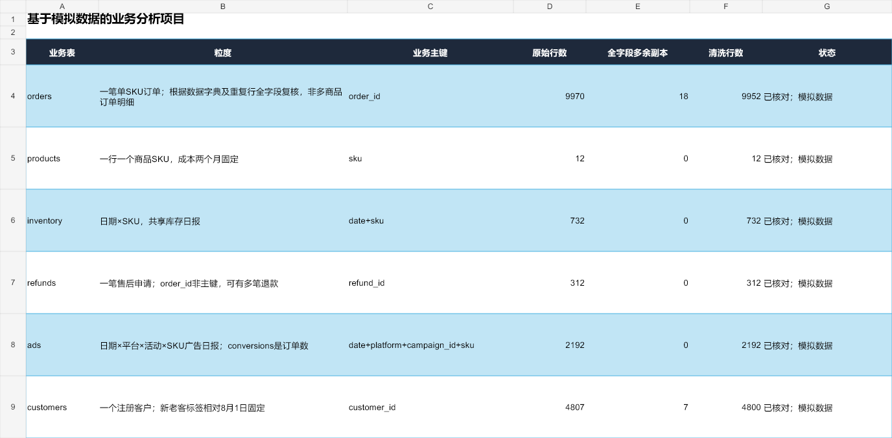
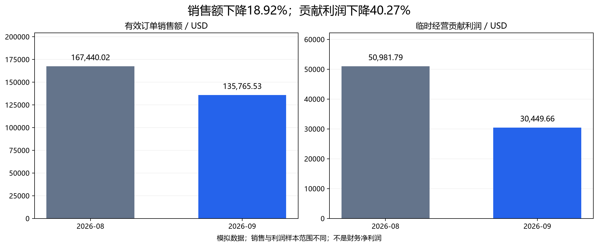
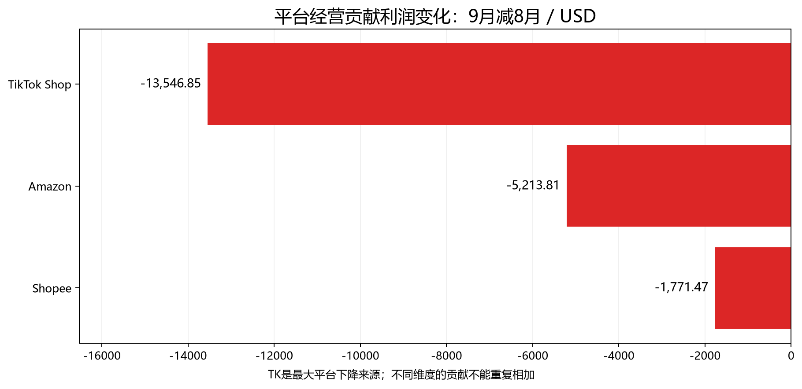
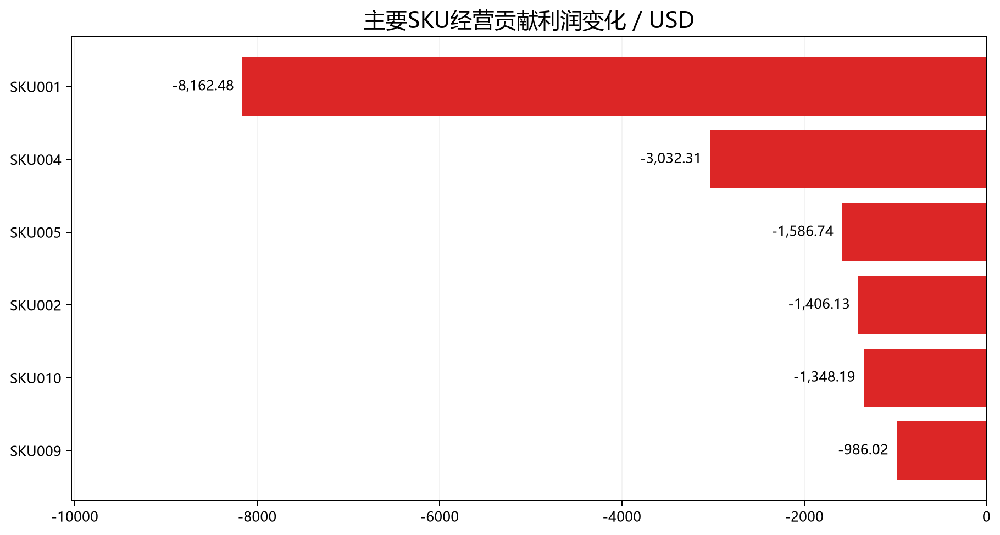
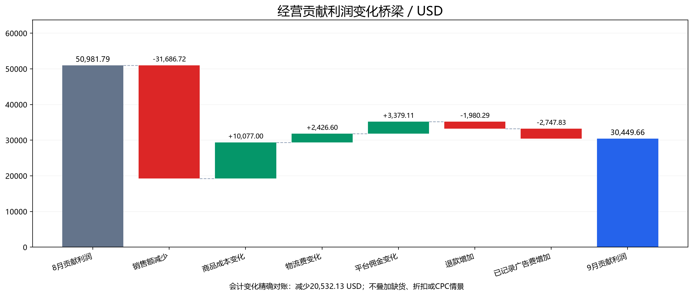
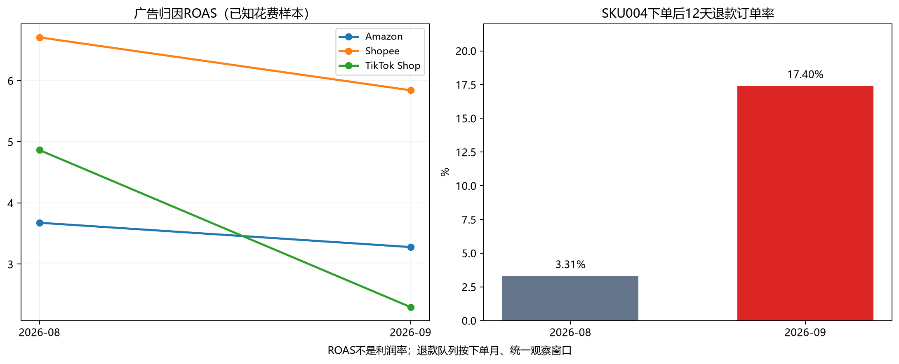
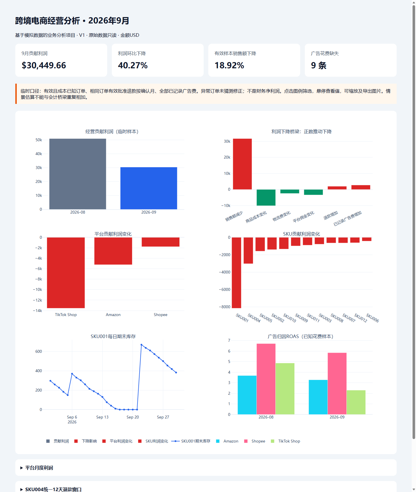

# 跨境电商经营数据分析与利润异常诊断

> V1 历史分析作品。当前主系统见 [V2.1 首页](README.md)。若要重跑下文完整 V1 构建，请使用独立副本：`scripts/build_portfolio.py` 会重建根 README，勿在 V2.1 发布工作区直接执行该构建步骤。

**Cross-border E-commerce Business Analytics & Profit Diagnostics**

> 本项目使用合成模拟数据，仅用于技能展示，不代表真实企业经营成果。由学习者使用Codex辅助开发，并进行业务口径学习、质量验证与结果审查。

## 项目简介

模拟广州一家约30人的跨境电商公司，通过TikTok Shop、Amazon和Shopee销售商品。围绕2026年9月经营下滑，使用六张关联表完成质检、清洗、SQL/Pandas分析与利润对账，交付经营报告、Dashboard和自动周报，为库存、促销、广告及售后排查提出建议。

**目标岗位：** 数据运营专员、数据分析助理、AI数据运营、业务运营分析助理。

## 核心经营发现

|指标或线索|V1结果|口径与边界|
|---|---|---|
|有效销售额|167,440.02 → 135,765.53 USD，下降 **18.92%**|去重、已完成、暂时排除价格/数量待核实订单|
|临时经营贡献利润|50,981.79 → 30,449.66 USD，减少 **20,532.13 USD（40.27%）**|成本已知订单、同范围确认退款、全部已记录广告费；不是净利润|
|TikTok Shop|贡献利润变化 **−13,546.85 USD**|最大平台下降来源；平台与SKU维度不能重复相加|
|库存|SKU001连续 **4天零库存**|同期完成订单为0，补货后恢复；实际损失需进一步核实|
|促销与广告|TK优惠率 **3.91% → 11.99%**；ROAS **4.87 → 2.30**|优惠承担方未知；ROAS使用花费已知广告记录|
|退款|SKU004退款订单率 **3.31% → 17.40%**|下单后12天内确认的有效批准退款，按下单月队列比较|

原始数据直接汇总的销售降幅约30.36%，经质检后变为18.92%，说明**先核实数据质量，再解释经营变化**是项目的重要环节。以上为描述与排查证据，不宣称已证明独立因果关系。

## 技术栈与工作方法

- **Excel/WPS**：字段理解、订单销售口径、透视表及初步异常检查。
- **Python、Pandas、NumPy**：六表质检、标准化、异常隔离、多表关联和经营指标。
- **SQL、SQLite**：CTE、分组聚合、关联与退款队列；独立复核Pandas结果。
- **Jupyter Notebook**：整理分析过程并从干净内核执行。
- **Matplotlib、Plotly**：真实数据静态图与离线交互Dashboard。
- **AI辅助**：Codex辅助代码/文档；周报先确定性计算，再生成AI证据包并验证指标引用，未自动调用付费API。

## 业务分析流程


## 数据集

六张原始CSV合计约1.1MB，完整包含在项目中，不使用仅能演示的抽样数据。金额统一USD等值；订单、库存和广告覆盖2026-08-01至09-30，退款观察至10-12，均为模拟日期。

|表|原始行数|粒度与关键字段|业务关系|
|---|---:|---|---|
|orders.csv|9,970|单SKU订单；order_id、order_date、quantity、unit_price、discount、order_status|关联客户、商品及售后；取消订单不确认收入|
|products.csv|12|每SKU；unit_cost、category、supplier|提供两个月固定的单位到仓采购成本|
|inventory.csv|732|日期×SKU；期初、入库、出库、期末|共享可售库存，与完成订单出库核对|
|refunds.csv|312|退款申请；refund_id、order_id、refund_date、refund_amount、refund_status|经订单归属平台/SKU，确认日用于费用期间|
|ads.csv|2,192|日期×平台×campaign×SKU；spend、clicks、attributed_revenue|广告按平台/SKU直接归属，归因收入不再加到销售额|
|customers.csv|4,807|每客户；customer_id、country、register_date|客户主表，缺少客户编号不直接删除订单收入|

字段详情见[数据字典](docs/data_dictionary.md)，样本和计算口径见[方法说明](docs/methodology.md)。

## 数据质量管理

确认订单为单SKU粒度后，复核18条全字段重复副本并去重，订单剩余9,952行且业务键唯一；客户去除7条整行重复。标准化SKU、国家、平台及日期，保留原字段供追溯。客户缺失12条保留；价格/数量异常、3笔未知SKU订单和2笔超额退款标记隔离，不猜测修正。

广告费用缺失9条，按观测固定活动模式发现4个疑似缺日报格点；库存检查覆盖日平衡、跨日承接及订单对账。**缺失值、未知成本和疑似漏报均不自动填0。**



可核查[质检报告](reports/data_quality_report.md)、[六表质检台账](docs/data_quality_log.xlsx)、[逐记录问题证据](data/processed/quality_issues.csv)。台账区分“技术处理已验证”与“业务原值待确认”。

## 经营分析结果

### 1. 收入与贡献利润



销售与贡献利润都下降；利润降幅更大。两项指标样本不同：销售统计保留未知成本SKU，利润样本额外排除这些订单，因此不能混用两张表的变化额。

### 2. 平台与商品定位



TK贡献利润减少13,546.85 USD，是优先排查平台；Amazon和Shopee分别减少5,213.81、1,771.47 USD。



SKU001贡献减少8,162.48 USD；SKU004减少3,032.31 USD。平台与SKU是同一利润变化的两种切片，不相加。

### 3. 可对账的利润变化



销售减少被部分商品、物流和佣金成本下降抵消，退款及广告费用增加进一步压低贡献利润。六项会计变化精确合计至20,532.13 USD；缺货、折扣与CPC情景不再叠加。

### 4. 广告与售后验证



TK点击量减少而CPC上升，ROAS下降；SKU004统一观察窗口内退款比例明显增加。优先核查广告活动组合、包装/运输凭证和商品描述，尚不能认定具体责任方。

完整推导及行动建议见[9月经营报告](reports/september_business_report.md)；[正式验收](reports/v1_acceptance_report.md)说明证据、限制与环境测试。

## Dashboard



[dashboard/index.html](dashboard/index.html)是已在本地浏览器验证的**离线HTML**，支持悬停、图例筛选和缩放。没有公开部署，也没有虚构在线访问链接。GitHub文件页不执行该HTML，请下载项目后打开文件。

## 运行与复现

已在 **Windows x64、Python 3.11.5** 全新虚拟环境，从原始CSV及空派生目录完整重跑；两个Notebook执行、SQL/Pandas与关键金额对账通过，六张清洗CSV及全部汇总CSV逐字节一致。其他操作系统未实测。

在项目根目录运行：

```bash
python -m venv .venv
# Windows PowerShell: ./.venv/Scripts/Activate.ps1
# macOS/Linux: source .venv/bin/activate
python -m pip install -r requirements-acceptance-lock.txt
python -m pip check

# 读取完整raw，质检清洗，执行SQL并生成报告、SQLite与Dashboard
python scripts/run_project_v1.py

# 整理Notebook、真实数据图和README（不改变经营计算）
python scripts/build_portfolio.py
python scripts/run_notebooks.py

# 生成确定性经营周报并验证结果
python scripts/weekly_report.py --start 2026-09-21 --end 2026-09-27
python scripts/validate_project_v1.py
```

也可用 `requirements.txt` 安装兼容范围，锁定文件记录已测试版本。Windows无法激活时直接用 `./.venv/Scripts/python.exe` 替代命令中的`python`，无需修改系统策略。安装依赖需要网络；核心分析不需要Node、Codex插件或私有运行库。

**数据准备：** 六张完整模拟raw及SHA-256清单已在仓库，无需生成或下载额外业务数据。流水线不调用生成脚本、不修改raw，重跑会覆盖派生结果。

**SQL分析：** `run_project_v1.py`实际执行[四个SQL查询](sql/)并输出`reports/tables/*_sql.csv`，与Pandas独立对账；数据库在`data/processed/business_analysis.sqlite`。退款、广告先聚合再关联，避免多对多放大。

**Notebook：** [清洗](notebooks/01_data_cleaning_v1.ipynb)与[分析](notebooks/02_business_analysis_v1.ipynb)可在VS Code或Jupyter打开；执行器使用当前解释器，不借用旧内核。历史学习Notebook仅保留在本地，不作为正式结果来源。

**报告与Dashboard：** 经营/质检Markdown由流水线生成；离线Dashboard直接打开`dashboard/index.html`。如浏览器阻止文件读取，可在项目根目录运行：

```bash
python -m http.server 8000 --bind 127.0.0.1
```

然后访问[仅本机Dashboard](http://127.0.0.1:8000/dashboard/index.html)。该地址不是线上站点，不公开部署。README截图是已验证快照，新的截图仍需真实浏览器渲染。

## 业务建议

|方向|数据支持的行动|需要进一步确认|
|---|---|---|
|库存|监控核心SKU覆盖天数、零库存与补货到货偏差，明确补货责任人|真实供应交期和未下单需求，不能直接用情景损失定库存|
|促销|按SKU贡献测算折扣底线，核实优惠承担方并设计对照试验|平台补贴与需求反应，不把额外优惠当可追回收益|
|广告|按活动/SKU复核CPC、ROAS及订单贡献，试验预算调整|活动组合、素材和受众变化，不能直接归咎竞价|
|售后|优先抽查SKU004损坏证据、包装批次及商品描述|售后原因标签不能证明物流或供应商责任|

以上是建议，未实施，不声称提高利润或节省真实费用。

## 项目限制与真实性

- 全部业务数据为模拟数据；无真实公司、客户或任职成果。
- 9条广告花费缺失、4条疑似漏报未补估；未知SKU成本和异常订单原值待确认。
- 经营贡献利润不包含工资、租金、税费等，**不等于净利润**。
- 情景估算不等于实际损失，也不等于措施实施后的收益；经营线索并未全部获得因果证明。
- 月总量包含31天与30天的差异；两个月不足以控制季节性和活动影响。
- AI用于辅助开发与文档，数值由脚本核验；周报示例没有自动联网调用模型。

## 项目结构与求职材料

```text
data/raw/          完整原始模拟数据与哈希清单
data/processed/    清洗表、异常证据及分析事实
notebooks/         两个正式V1 Notebook
sql/               查询与独立指标验证
scripts/           V1流水线、构建、周报与检查
reports/           经营/质量/验收报告及汇总CSV
dashboard/         离线交互页面
docs/              字段、方法、质检台账与简历材料
assets/images/     真实数据展示图与已验证截图
```

[中文/英文简历描述与面试介绍](docs/resume_project_description.md) · [发布前检查清单](reports/github_release_checklist.md) · [第三方与许可说明](docs/third_party_notices.md)

本项目原创代码、文档、分析图及合成模拟数据采用[MIT许可证](LICENSE)。第三方内容仍遵循其自身许可：离线Dashboard保留Plotly版权说明并附原包MIT文本，不分发系统字体。Dashboard仅供离线或本机访问，不公开部署。

## English Summary

This synthetic portfolio project investigates month-over-month changes in a small cross-border e-commerce business across TikTok Shop, Amazon and Shopee. Six related tables support data-quality checks, transparent exception handling, SQL/Pandas reconciliation and profit diagnostics.

Effective sales declined **18.92%**. Provisional operating contribution fell **USD 20,532.13 (40.27%)**, with TikTok Shop showing the largest platform decline. Stock availability, discounts, advertising efficiency and refund cohorts provide investigation leads, not proven independent causal effects.

Deliverables include executed notebooks, SQL queries, auditable reports, an offline dashboard and a reproducible weekly reporting workflow. Results are based on synthetic data, exclude unresolved records under disclosed rules, and do not represent net profit or realized business gains. Development was assisted by Codex; AI involvement is disclosed.
