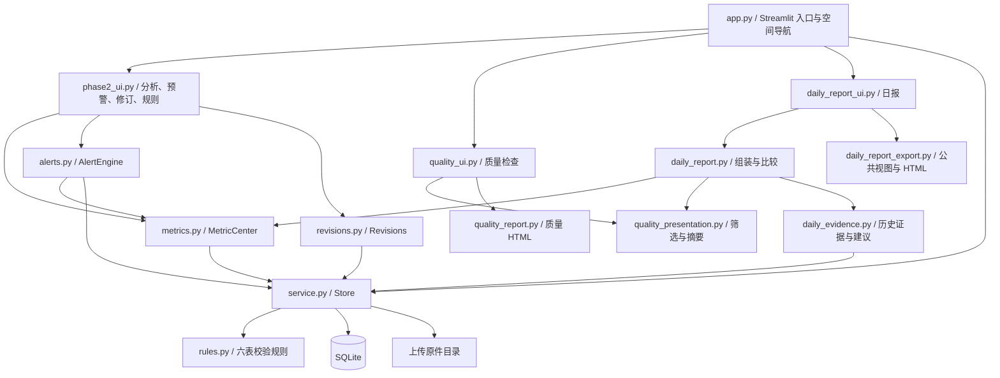
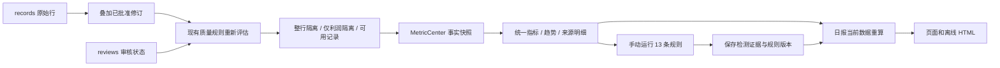

# V2.1 架构与数据流

本说明对应 C2 功能提交 `3739832fa4d2adf6becebfe213616233e8b0ad5f`。图中均为仓库现有模块，无独立 API 服务器、消息队列、AI 服务或调度器。路径相对仓库根目录。

## 模块依赖

页面通过 Store 获取异常后传给质量展示层；日报的 HTML 使用页面已组装的数据，不再次调用指标或预警检测。箭头表示主要调用/数据依赖，不代表独立部署服务。

## 可复用接口

|职责|实际接口|数据与副作用|
|---|---|---|
|导入与质量|`v2/service.py: Store.ingest / evaluate / refresh / anomalies / review`|保存原件、批次与不可变记录；重评质量；审核写审计，不直接修改原值|
|质量展示|`v2/quality_presentation.py: prepare / select / summarize`|异常 DataFrame 转展示行、筛选与当前影响摘要；历史明细不改变当前摘要|
|质量报告|`v2/quality_report.py: build_report / report_html`|消费筛选结果和摘要，生成转义后的离线 HTML|
|有效版本|`v2/revisions.py: effective_rows / Revisions.request / decide`|原值叠加已批准修订；申请与审批记录追加，批准后重新质检|
|指标中心|`v2/metrics.py: MetricCenter.facts / calculate / trend`|当前有效事实、含样本/限制/明细的指标字典、日趋势；缺失不随意填零|
|规则与历史|`v2/alerts.py: AlertEngine.configure / run / action`|配置新版本、手动检测与证据写入、处理状态留痕；`rules()` 可初始化默认规则，不是纯读接口|
|日报|`v2/daily_report.py: build_daily_report / compare / formatted`|调用统一服务计算 D 和 D−1，组装 `current/previous/states/comparisons/history/guidance`|
|历史证据|`v2/daily_evidence.py: read_history / build_guidance`|只读关联检测证据与规则快照；完整证据驱动核查建议，并提示数据使用限制|
|日报导出|`v2/daily_report_export.py: public_view / report_html`|允许字段清单、统一格式、文本转义；HTML 不查询数据库或重新计算|

## 有效数据路径

审核“确认”表示异常属实，仍隔离；只有可放行的软规则允许驳回，硬错误仍阻断。批准修订不保证记录必然可用，仍须通过质量检查。修订后页面指标基于当前有效版本重算；经营预警需用户再次运行检测，旧证据不覆盖。

## SQLite 与文件

`v2/schema.sql` 保存基础结构，`v2/migrate.py` 与 `v2/migrations/` 管理追加迁移。

|表组|关系与用途|
|---|---|
|`batches → records → anomalies → reviews`|导入批次、来源行、质量问题、追加审核|
|`operation_logs`|操作审计，含空间与对象标识|
|`record_revisions → revision_reviews`|关联原始记录的修订和审批；原始 records 不覆盖|
|`alert_rules → alert_rule_versions`|当前规则与历史配置版本|
|`alerts → alert_detections / alert_actions`|预警对象、检测证据、处理历史；保留规则快照|
|`schema_migrations`|迁移版本、校验和与备份位置|

SQLite 使用外键、事务和 WAL。上传原件另存磁盘；文件与数据库不是一个原子事务。逻辑空间由 workspace 区分；第二阶段模拟另用 `phase2_demo/` 数据目录。不是多租户权限系统。

## 时间边界

日报经营日 D 是已结束的订单日；D−1 为前一自然日。H 仅约束退款观察成熟度。历史证据按 `evidence_json.period.end == D` 及空间筛选，同规则版本/对象/窗口取最新留存触发；展示检测保存时间、参考日、版本与标识。当前状态不能还原 D 当时状态，证据留存也不证明所有规则都在当日完整运行。

## 测试组织

`v2/tests/` 包含导入、隔离、审核、指标、规则、修订、质量报告、日报与 Streamlit AppTest。`v2/*browser*.cjs` 为独立 Edge/Playwright 验收脚本。C2 脚本同时对账页面、HTML 和数据库快照；它会建立模拟场景并写入测试库，不能对业务目录运行。

[返回首页](../../README.md) · [演示流程](DEMO.md)
