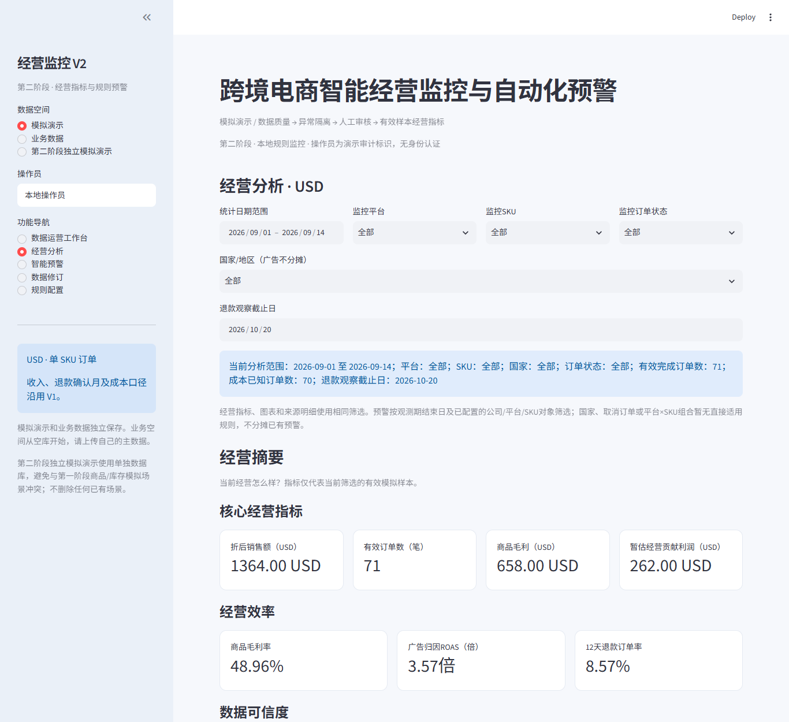
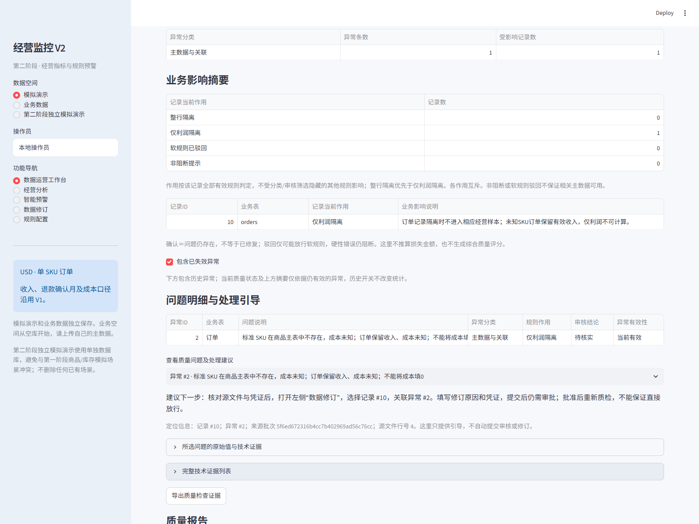
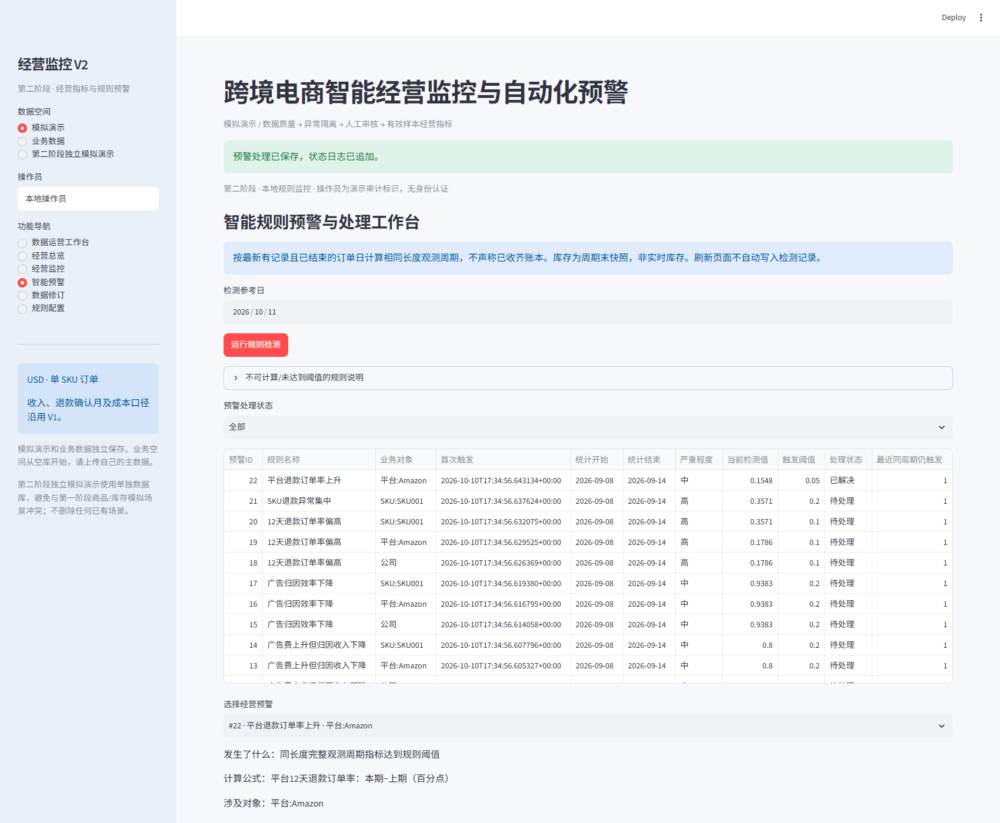
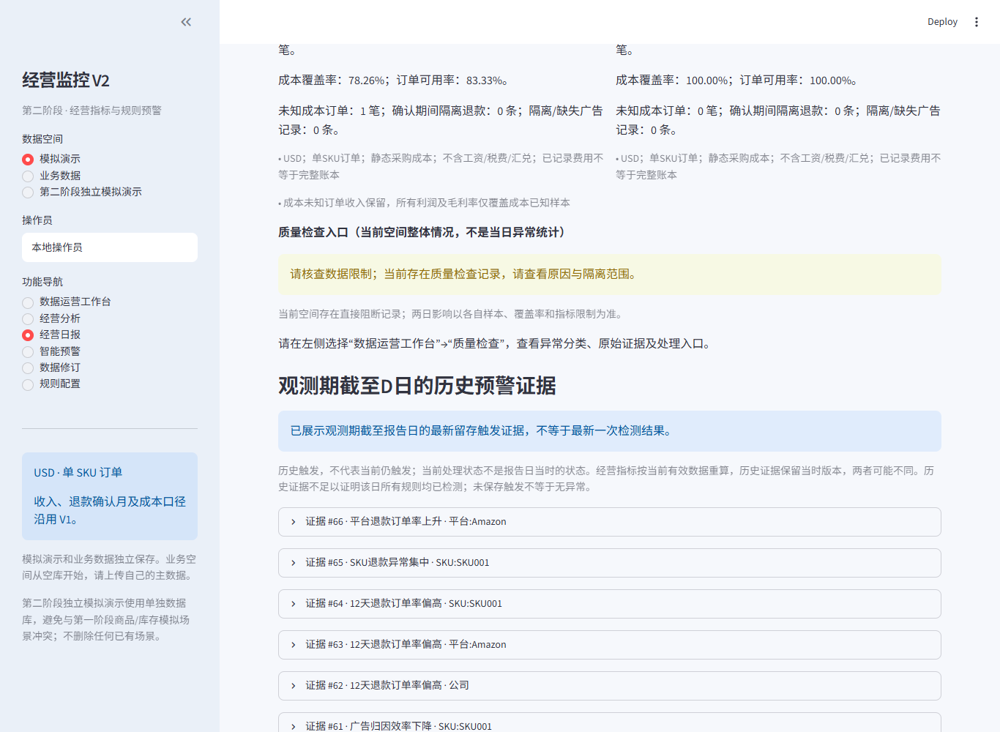
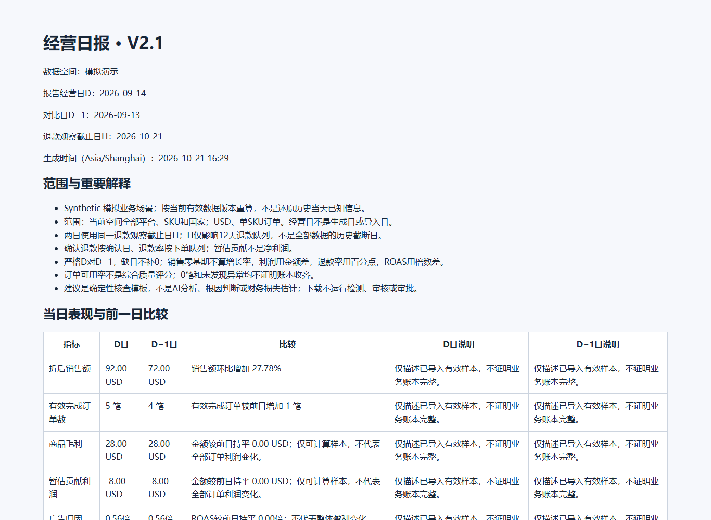

# V2.1 展示材料、验证证据与公开发布说明

> **当前状态更新（2026-10-26）：** V2.1公开Synthetic演示已上线，[在线体验](https://ecommerce-business-analysis-izcmrhydxddnasxqdbdxxr.streamlit.app/)。当前求职材料见[业务案例](BUSINESS_CASE.md)、[面试指南](INTERVIEW_GUIDE.md)和[线上截图](SHOWCASE.md)。本页下文是2026-10-21历史整理记录；“未推送、未部署”等表述仅描述当时，不代表当前状态。正式GitHub版本以[main](https://github.com/linluluhh/ecommerce-business-analysis/tree/main)与提交记录为准。

整理日期：2026-10-21。发布候选采用 origin/main 上的单次文件快照；本地 V2 中间开发历史不进入发布分支。详见 [本次发布候选](RELEASE_CANDIDATE.md)。功能基线：`3739832fa4d2adf6becebfe213616233e8b0ad5f`。本轮只更新文档、展示副本及发布相关忽略/脱敏配置，不修改业务计算。未推送、未部署、未合并主分支。

## 截图来源

以下均为应用实际浏览器截图，原样复制，无 UI 合成或数值修改。不同阶段的截图不代表同一数据库状态或同一次验收。源路径均为仓库相对路径；runtime 原件保留本地、未发布。副本哈希及来源见 [materials.json](materials.json)。

|图片|实际来源与边界|
|---|---|
|经营分析|独立仓库 V2.0.5 恢复验收 `v2/runtime/v205-rebuild/browser/01-summary.png`；旧导航尚无经营日报|
|质量与证据|独立仓库 Phase B 验收 `v2/runtime/v21-quality-b/browser/03a-guidance.png`；筛选后的示例，不代表所有问题|
|预警处理|原项目第二阶段历史验收 `v2/evidence/phase2/03-alert-workbench.png`；旧导航、旧数值格式，不冒充 C2 新截图|
|日报、历史证据、移动端与离线 HTML|独立仓库 C2 验收 `v2/runtime/v21-daily-c2/browser/`；主场景未批准负价修订，D=2026-09-14、H=2026-10-21|

### 经营分析 Dashboard（V2.0.5 历史实拍）

### 数据质量与异常处理引导（V2.1 Phase B 实拍）

### 预警处理（第二阶段历史实拍）

### 经营日报与历史证据（V2.1 C2 实拍）

### 离线 HTML 日报（V2.1 C2 断网打开实拍）

[下载 HTML 样例](../../assets/v21/sample-daily-report.html)后用浏览器打开。它是 Synthetic 验收快照，不是动态查询，也不是线上服务。

[480px 移动端真实截图](../../assets/v21/daily-mobile.png)保留窄屏证据。

## 已有验收证据

|范围|实际结果|证据|
|---|---|---|
|C2 + C1 专项|26 passed，26.32 秒|原件 `v2/runtime/v21-daily-c2/specialist-fixed.log`；[公开副本](pytest-specialist-c2.txt)|
|C2 全量回归|176 passed，140.21 秒|原件 `v2/runtime/v21-daily-c2/pytest.log`；[公开副本](pytest-c2.txt)|
|C2 Edge/Playwright|passed=true，errors=[]|[结果副本](browser-c2.json)，原件 `v2/runtime/v21-daily-c2/browser/results.json`|

浏览器覆盖日期/H、六项 KPI 与严格前日比较、空库/无匹配/退款未成熟、空间隔离、1366px/480px、既有导航、历史窗口与版本、确定性建议、HTML 下载/离线打开/逐项对账，以及审核、修订、预警、日志和指标只读不变性。测试结果仅代表对应版本及 Synthetic 场景，不证明真实企业收益、生产安全或任意数据都正确。

本轮文档与展示检查：本地链接全部有效；8 个展示文件与来源逐字节一致；7 个脱敏 JSON 的非路径字段保持一致；新增敏感文件忽略模式已验证生效；HTML 样例无脚本或外部资源标签。示例工作簿作者元数据仅发现 openpyxl 库标识。

本轮未重跑完整测试或浏览器验收。原始 XML、数据库快照、服务器日志等继续保留在本地 runtime，不为了展示将整套运行目录加入 Git。

## 公开文件检查与处理

- 当前 Git 跟踪清单未包含 SQLite、数据库 WAL/SHM、`.env` 或本地运行库；`v2/runtime/` 与虚拟环境原本已忽略。
- 本轮补充 `.env.*`、Streamlit secrets、SQLite/DB 及 WAL/SHM、私钥文件的忽略规则。忽略规则不清理已有历史，也不能替代人工检查。
- 已跟踪文本的常见 API token、AWS access key、私钥标记扫描未发现匹配；这是有限模式扫描，不是“绝无密钥”的保证。两处路径模式为路径检查正则和 `SecretUser` 合成安全测试样例，非真实用户信息。
- 开发版曾为 7 个历史验收 JSON 制作路径脱敏副本。本次发布进一步排除 `v2/evidence/` 下全部 15 个原始 JSON/XML（含主机名、运行状态和重复结果）；未精选的 20 张历史截图也不重复打包。完整材料仍保留在本地开发仓库，未删除。公开验收选用 `docs/portfolio/` 中精选输出与展示截图。
- 新展示材料不包含机器用户名、数据库绝对路径或完整运行日志；截图为页面内容，操作员为模拟标识。HTML 为现有安全导出样例，未手工改写结果。
- 首页依赖/启动命令统一为仓库相对路径；锁定依赖和现有运行入口保留。未为了文档修改依赖版本，也未声称本轮重新安装验证。
- 全部示例数据为 Synthetic；业务数据上传后仍应留在本地忽略目录，作品集发布不需要任何真实客户文件。

## Git 历史与发布边界

本次发布分支以 GitHub V1 main `c7146b45806386d194c88c2109fd25a71b6dae9a` 为父提交，仅引入 V2.1 文件快照，不继承本地 V2 中间开发提交。开发仓库的完整历史继续本地保留；本轮没有重写已公开历史。

A 类：V1 原本公开的四个提交和文件保留，原作者使用 GitHub noreply 邮箱。B 类：本地开发提交里的路径及非 noreply 邮箱不随本次快照提交进入公开历史。C 类：新提交使用已有公开的 GitHub noreply 身份；新增文件已排除原始机器报告，保留合成路径安全测试而非真实个人信息。

发布前仍需仓库所有者授权推送；远程 main 若在准备后前进，必须重新检查差异，不强推。是否创建 V2.1 tag/release 属于后续选择。本轮未推送、未创建远程分支、未部署。

[返回首页](../../README.md) · [复现演示](DEMO.md) · [架构图](ARCHITECTURE.md)
